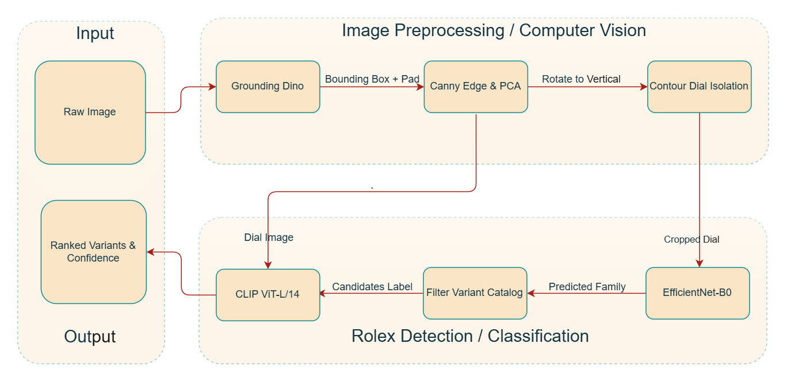

# [Rolex Finder(Click to see the website)](https://rolexfinder.onrender.com/)
# [Youtube Demo (Click to see)](https://www.youtube.com/watch?v=IgFWka6LJgQ)
An web-appp to identify Rolex watches for raw user upload of images. The pipeline used in this project can detect the specific variant with reference ID of the Rolex model using a combination of Deep Learning + Classical Computer Vision + Zero-Shot Foundation Model.

I built this project because I love for watches, I built a ML pipeline to detect Rolex elegant timepieces; and my friend created a beautiful web interface for it. 

## Authors
| **Phong Nguyen (Alex)** | **Huy Phan (Hertzy)** |
|---|---|
| **Deep Learning & Backend** | **Web Developing / UI-UX Design** |
| Built the Rolex classification model, web-scraping pipeline, recognition pipeline, backend API, model integration, and Modal deployment setup. | Developing the website from [Figma design](https://www.figma.com/design/JvzpwAEPhSpTFqzpf72Ezh/Rolex_Recog_UI?node-id=0-1&t=oeYxbgn8zixFBz3F-0): Creating interactions, visual effects, UI&UX refinement, and Vercel deployment. |
| GitHub: [@AlexDaPiggie](https://github.com/AlexDaPiggie)<br>LinkedIn: [Hoai Phong Nguyen](https://www.linkedin.com/in/hoai-phong-nguyen-9367a4384/)<br>Portfolio: [Phong Nguyen](https://phongnguyen.vercel.app/) | GitHub: [@hertzy-da-poet](https://github.com/hertzy-da-poet)<br>LinkedIn: [Huy Phan](https://linkedin.com/in/huy-linkedin) |


---

# Primary Features
## Frontend
-   **Intuitive Image Upload:** Supports pasting from the clipboard (Ctrl+V), browsing local files, and drag-and-drop functionality.
-   **AI-Powered Model Prediction:** Displays the most likely Rolex model with the % of confidence.
-   **Variant Candidate Analysis:** Shows a list of the closest known model variants, each with a match score and reference IDs.
-   **Quick Reference Search:** Provides one-click links to Google Images for each reference ID to aid in visual comparison and confirmation.
-   **Detailed Probability Breakdown:** Presents a table with the model's confidence scores across various Rolex families (e.g., Cellini, Daytona, Submariner).
-   **Responsive Design:** Features a clean, two-panel layout that adapts seamlessly to both desktop and mobile devices.
-   **Built-in Tutorial:** An interactive guide on the homepage helps first-time users get started quickly.

## Backend
- **Open-Vocubulary Object Detection**: Locates the watch in user's upload photos using Grounding DINO (Zero-shot object detection model). No mannual cropping needed.
- **Rotation Alignment**: Uses "Canny Edge Detection" to detect the edge of the bracelet, and uses "PCA" to align the watch vertically (12 o'clock facing up).
- **Contour Dial Isolation**: Filters the 78% center (78% of the width & height), scores contour roundess, aspect & fill ratio, and center distance to crop the dial face.
- **2-Stage Classification**:
    - **Stage 1**: Fine-tuned **EfficientNet-B0** classifies watch into 14 Rolex families (models), including Submariner, Daytona, Datejust, GMT-Master,... (See child-folders in ./data)
    - **Stage 2**: Zero-shot CLIP (openai/clip-vit-base-patch16) ranks specific reference variants (dial color, bezel type, material,...)
- **Direct Reference Links**: Generates one-click Google Images queries for the predicted reference IDs (e.g. `116610LN`, `126610LV`).
- **Serverless Cloud API**: Hosted on Modal (NVIDIA L4 GPU) with pre-baked Hugging Face cache layers and auto scale-down to disconnect when not in use (scaledown_window = 1200s).
 

## Architecture Pipeline


1. **Detect the Watch (`Grounding Dino` model)**: Scans the uploaded image for the watch and crop it out of the background.
2. **Straighten the Angle (`OpenCV + PCA`)**: Rotates the image's direction so that the watch is aligned vertically (12 o'clock facing up).
3. **Zoom into the Dial (`Contour Detection`)**: Detects the watch's dial (a round circle) and crop it out. 
4. **Identify the Rolex family (`EfficientNet-B0`)**: Classifies the watch into 1 of 14 known Rolex models (Submariner, Daytona, Datejust,...)
5. **Match the Exact Variant (`OpenAI CLIP`)**: Compares with the descriptions (e.g. bezel, dial color, material,...)for each family's variant in the catalog. 
6. **Returns the Confidence score & Ids**: Outputs the confidence score of the predictions, and the top-3 specific reference IDs (e.g., `115510LN`) with Google search link for images of that watch. 

---
## How to Run this on Local?
### Prerequisites
- Python 3.11+
- Node.js 18+
- Hugging Face Access Token (`HF_TOKEN`)

### 1. Backend Setup

```bash
# Clone repository
git clone https://github.com/AlexDaPiggie/Rolex_Finder_DeepLearning_Model.git
cd rolex_models_recognition

# Create virtual environment
python -m venv venv
venv\Scripts\activate      # Windows
# source venv/bin/activate # Linux/macOS

# Install dependencies
pip install -r requirements.txt

# Export Hugging Face token
$env:HF_TOKEN="your_hf_token"     # Windows PowerShell
# export HF_TOKEN="your_hf_token" # Linux/macOS

# Run FastAPI dev server
uvicorn src.api.main:app --host 0.0.0.0 --port 8000 --reload
```

- API Base URL: `http://localhost:8000`
- Swagger Docs: `http://localhost:8000/docs`

### 2. Frontend Setup

```bash
cd front_end
npm install
npm run dev
```

- UI URL: `http://localhost:5173`

### 3. Training & Evaluation (Optional)

#### Prepare Dataset
Organize data inside `data/processed/` with class folders:
```
data/processed/
├── train/
│   ├── submariner/
│   ├── daytona/
│   └── ...
├── val/
└── test/
```

#### Train Model
Fine-tune EfficientNet-B0 on the 14 Rolex families:
```bash
python -m src.training.train --epochs 5 --batch-size 16 --learning-rate 1e-4
```
- Automatically saves the best checkpoint to `models/rolex_classifier_model.pt`.

#### Evaluate Model
Evaluate the trained checkpoint on the test set:
```bash
python -m src.training.evaluate
```

---

## Benchmark

Run `python -m src.training.benchmark --check-leakage` to measure the family classifier on the held-out test split. Full tables (per-class scores, confusion pairs, calibration) are in [`docs/benchmark.md`](docs/benchmark.md).

| Metric (14 families, 3,731 test images) | Value |
|---|---|
| Top-1 accuracy | 99.2% |
| Top-3 accuracy | 99.9% |
| Macro F1 | 0.985 |

**Read this carefully:** this is an optimistic upper bound. The test images come from the same retailer as the training images, about 13% of them have a near-duplicate in the training set, and it measures the classifier only (not detection, alignment or variant matching) and not real phone photos. See [`docs/training_data_plan.md`](docs/training_data_plan.md) for the plan to get an honest number.

Each `/predict` response includes `timings_ms` (decode, preprocess, classify, variant_match, total), and `/health` reports `startup_timings_ms` for model loading, so the cold start can be measured. Add `?include_steps=true` to `/predict` to get the preprocessing step images (debug only).

## Serverless Cloud Deployment (Modal)

[`modal_app.py`](modal_app.py) configures serverless GPU execution:

- **Build-Time Model Pre-baking**: Hugging Face models (`grounding-dino-base`, `clip-vit-base-patch16`) are downloaded during container build via `.run_function()`, eliminating cold-start download latency.
- **Auto Scale-Down**: Shuts down GPU after 20 minutes idle (`scaledown_window = 1200s`). `min_containers` defaults to 0; set `ROLEX_MIN_CONTAINERS=1` when deploying to keep one GPU warm (about $0.80/hour on an L4) before showing the site to someone. Up to 3 containers run in parallel so visitors do not queue.

```bash
modal secret create rolex-huggingface HF_TOKEN=your_token
modal deploy modal_app.py
```

---

## Repository Structure

```
Rolex_Finder_DeepLearning_Model/
├── data/                       # Scraped dataset & processed class mappings
├── front_end/                  # React + Vite frontend source
├── models/                     # PyTorch model weights (.pt)
├── src/
│   ├── api/
│   │   └── main.py             # FastAPI router, CORS, and inference endpoint
│   ├── collection/             # Web scraping scripts
│   ├── detection/
│   │   └── watch_cropper.py    # Grounding DINO detection, PCA alignment, contour dial extraction
│   ├── identify/
│   │   ├── clip_matcher.py     # Zero-shot CLIP ranking pipeline
│   │   ├── rolex_variants.json # Variant reference IDs and prompt catalog
│   │   ├── summary.py          # Output formatting utilities
│   │   └── variants.py         # Catalog lookup helpers
│   ├── inference/
│   │   ├── device.py           # Device resolver (CUDA / CPU fallback)
│   │   └── warmup.py           # Pre-warm model cache in memory
│   └── training/
│       ├── dataset.py          # PyTorch Dataset and augmentations
│       ├── evaluate.py         # Evaluation and validation metrics
│       ├── models.py           # EfficientNet-B0 architecture definition
│       └── train.py            # Training loop
├── modal_app.py                # Modal serverless GPU configuration
├── requirements.txt            # Python dependencies
└── README.md                   # Project documentation
```

---

## What are the Limitations of this Project ?
- **False Positives on images containing no watch**
    - The pipeline relies entirely on Grounding Dino with the prompt `"watch. wristwatch"` to detect whether a watch appears in the image or not. Consequently, if there's an object that looks like a watch/wristwatch, or in shape round, clocks, having bracelets,...; they would be mistaken for a watch. 
    - This problem could be addressed in the future by adding a particular watch classification model or a stricter bounding box.

- **Closed Catalog Constraints**
    - The model can only classify the 14 trained Rolex families in the catalog and could only detect among the variants for each family in [`rolex_variants.json`](src/identify/rolex_variants.json). Rolex pieces that don't appear in the catalog couldn't be recognized. 
    - This is a trivial problem because the catalog for Rolex families almost cover all common/uncommon Rolex watches found on the Internet. Only rare/vintange/unique off-catalog watches could run into this problem. 

- **Severless cold-start latency (~40s)**
    - Modal platform scales down to 0 CPU instances when idel to elimate hosting costs. When cold start, it takes roughly 40 seconds to spin up the container and load models into GPU memory.
    - Because this project is maintained by one person with insufficient funding, running GPU 24/7 is impossible. The website employs a simple solution for this by implementing a lightweight CPU-based warm-up ping (Loading the Modal platform right at the moment someone opens up the website). 

- **Limited model architecture exploration**
    - The classifier currently only uses fine-tuned EfficientNet-B0 without benchmarking against other modern computer vision architectures. The reason is because training and benchmarking cost a huge amount of time (training EffNet-B0 takes ~5 hours), which would expand the time cost for this project significantly, not to mention that EfficientNet-B0 has already been an outstanding architecture for this project.
    - In the future, it's worth experimenting with ConvNeXt, Swin Transformers, or deeper EfficientNet variants (B4/B7) to compare the accuracy - latency trade-offs.

- **Ambiguity in CLIP**
    - The reason why CLIP is used in the first place is because training EfficientNet-B0 on every single Rolex variant would be an incredibly tedious task, requiring huge amount of data and time training, leaving alone the size of the model and latency for loading it on Modal. Hence, CLIP emerges as the best alternative for this problem. 
    - However, because CLIP embeddings rely entirely on text description, variants with similar description (metals, style, dial,...) could easily be mistaken for one another.


---

## Data Quality Improvements

Short log of what was wrong with the data and what was done. Details: [`docs/training_data_plan.md`](docs/training_data_plan.md).

### Problems found
- **One source only.** All training photos come from one retailer (swisswatchexpo). Clean studio shots. Real phone photos look different.
- **Train and inference did not match.** Training used full photos. The website feeds tight dial crops.
- **Test set leaked.** Split was random per photo. Other photos of the same watch sat in train and test. First check: 13% of test images had a near-duplicate in train.
- **Some wrong labels.** Retailer category pages are not always right (for example a Datejust listed under Oyster Perpetual).
- **Very uneven classes.** Datejust about 6,000 train images. Milgauss about 150.

### What was done
1. **Benchmark first.** `python -m src.training.benchmark --check-leakage` gives top-1, top-3, per-class scores, calibration and a leak check. See [`docs/benchmark.md`](docs/benchmark.md).
2. **Group split.** `src/training/group_split.py`. All photos of one listing go to the same split. Output: `data/grouped`.
3. **Label audit with two independent signals.** `src/training/audit_labels.py`.
   - Signal 1: family named in the image file name.
   - Signal 2: what the current model predicts.
   - Both agree on another family: relabel. Signals conflict with the label and each other: remove. Model sides with the label: keep (families overlap, for example a Datejust on a President bracelet).
   - Result: 74 images relabelled from a first review page (model confident), then 17 relabelled and 10 removed by the audit. About 0.4% of the data.
4. **Removed leaked images.** `src/training/dedupe_splits.py`. 659 val/test images that copy a train image were moved to `data/grouped/_removed/leak`. Hash: 256-bit difference hash, distance 6 or less. (A first 64-bit hash flagged 96% of images. Too coarse, replaced.)
5. **Crop like the website.** `src/training/prepare_crops.py` runs detect, align, dial crop on every training image. Images where no watch is found are dropped, because the website would reject them too. Runs on a Modal GPU (`modal_train.py`).
6. **Class balance.** Loss weights by inverse class frequency (`--balance loss`).
7. **Phone-photo augmentation.** Blur, JPEG compression and glare added to training (`src/training/dataset.py`). No horizontal flips (they break dials and crown side).
8. **Open-licence real photos.** `src/collection/commons.py` collects Wikimedia Commons photos (CC0, public domain, CC BY, CC BY-SA only) with author and licence in `data/commons/manifest.csv`. Meant for a real-world test set, not mixed into training. Yield is small (few photos for rare families) and Commons rate-limits scripts hard.
9. **Preprocessing bugs fixed.** EXIF rotation, wrong dial box height, watch turned upside down by 180 degrees, black corners after rotation.

### Not done, and why
- **More retailer scraping.** Checked a few retailers. Listing pages are rendered by JavaScript, some robots.txt files set slow crawl delays for AI crawlers, and terms of use are unclear. Low gain for the risk. Better source: your own photos and consented user uploads.
- **Offline synthetic copies.** On-the-fly augmentation does the same job without storing more files.

### Still open
- A bigger, hand-checked real-world test set (20-30 photos per family, not from the retailer). It is the number that matters. Started with 73 photos, see Results.
- "Not a Rolex" negative images, to train and test out-of-scope rejection.
- Reference-level labels (for example 116508) to replace CLIP text prompts with photo retrieval.

### Results
Cleaned data: 18,826 train / 2,076 val / 2,006 test images (14 families). Leak rate of the test set: 13% before, 0.3% after (6 images).

Modal GPU run (crop, train 10 epochs with class-balanced loss, benchmark), same test split for both models:

| Model | Top-1 | Top-3 | Macro F1 | Calibration error (lower is better) |
|---|---|---|---|---|
| New model (`models/candidate.pt`, trained on cleaned, cropped data) | 99.45% | 99.90% | 0.992 | 0.003 |
| Current live model | 99.45% | 99.95% | 0.994 | 0.006 |

What this means:
- **No measurable gain on this test set.** Both score the same. The live model was trained on images that overlap this test set (old random split), so its number is inflated. The new model never saw these images, so its number is the honest one. The new model is better calibrated.
- **This test set is too easy.** Same retailer, same clean photos. It cannot show whether the new model works better on phone photos. The real-world test set (see "Still open") is needed for that.
- The crop step found a watch in all but 1 of 23,000 images, so almost nothing was dropped.
- The live model was not replaced. Compare both on real photos first.

**First real-world check.** 73 open-licence photos (Wikimedia Commons and Flickr via Openverse: wrists, shop windows, events), full pipeline through the live API: 24 of 73 correct (33%). The labels come from titles and categories, so some are wrong, and the set is small. Do not trust the exact number. It does show that the 99% above does not carry over to real photos. Collector: `src/collection/openverse.py` (rate-limited, so growth is slow). Images are private (not in the repo) because some licences forbid redistribution.

Full tables: [`docs/benchmark_candidate.md`](docs/benchmark_candidate.md) and [`docs/benchmark_baseline_grouped.md`](docs/benchmark_baseline_grouped.md).
